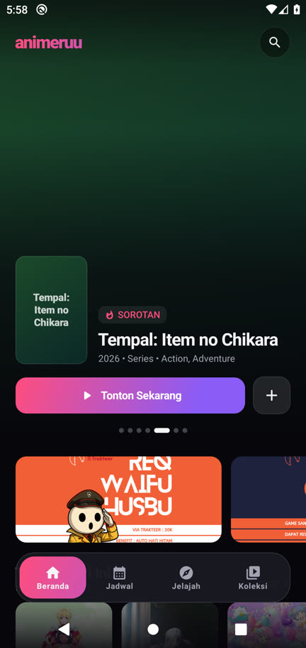
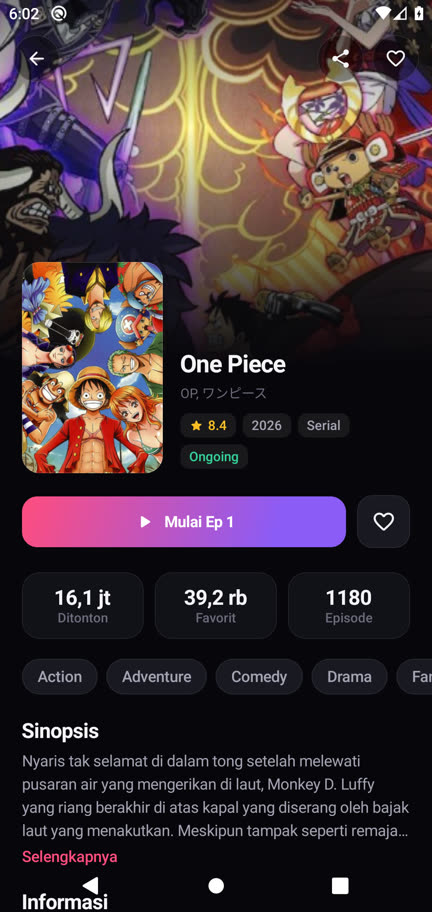
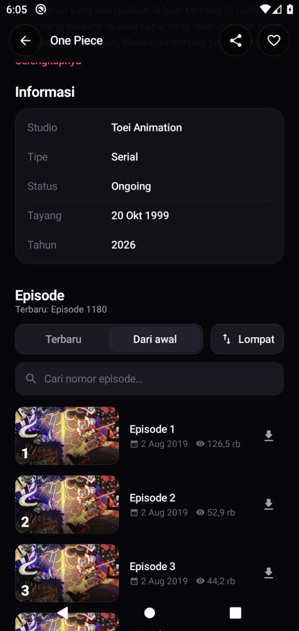
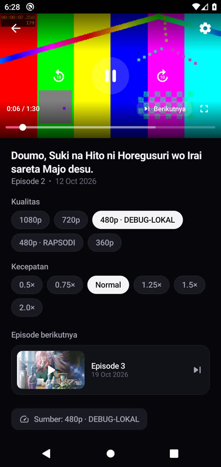
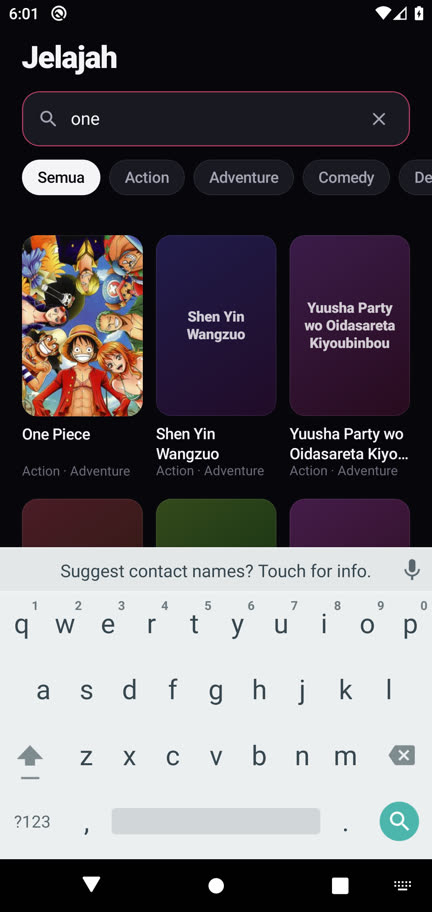
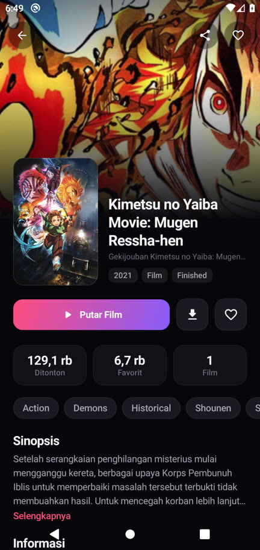
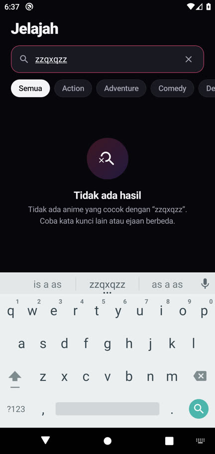
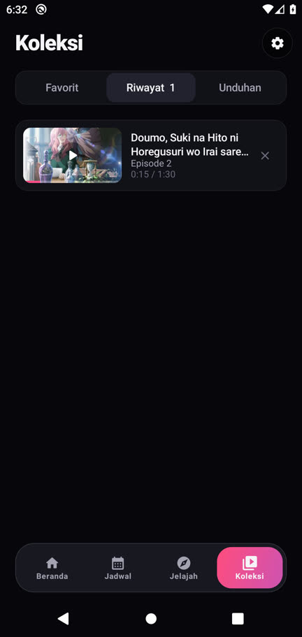

# Animeruu

Aplikasi Android streaming anime. Satu-satunya sumber data adalah **REST-ANIM API**
(`https://rest-anim.vercel.app`), ditambah gambar dari CDN yang dirujuk API dan Kitsu
(lewat `/api/poster`). Tidak ada akun, tidak ada API key, dan tidak ada layanan pihak ketiga lain.

- **applicationId:** `dev.animeruu.app` (debug: `dev.animeruu.app.debug`)
- **minSdk 26 · targetSdk 35** · APK release ±2,5 MB (R8 + shrink resources)

| Beranda | Detail (One Piece) | Episode "Dari awal" | Pemutar + kontrol |
|---|---|---|---|
|  |  |  |  |
| **Jelajah** | **Detail film** | **Pencarian tanpa hasil** | **Riwayat / resume** |
|  |  |  |  |

---

## Keputusan arsitektur

### Stack
| Lapisan | Pilihan | Alasan |
|---|---|---|
| UI | **Jetpack Compose** (BOM 2024.12), Material3 hanya sebagai fondasi, design system sendiri | Animasi berbasis fisika ada di semua lapisan; shared element transition bawaan |
| Navigasi | Navigation Compose 2.8, **rute bertipe** (`@Serializable`), `SharedTransitionLayout` | Argumen aman-tipe; poster "terbang" dari kartu ke detail; predictive back aktif |
| Jaringan | **OkHttp + kotlinx.serialization**, klien kecil sendiri (`ApiClient`) | Kendali penuh atas retry, cache, dan amplop `{ok,data,pagination,error}` |
| Gambar | **Coil 2** (cache memori 25% + disk 300 MB, header cache diabaikan) | Cache agresif; *crossfade*; placeholder memori untuk muatan progresif |
| Player | **Media3 ExoPlayer** + `CacheDataSource` + `DefaultDataSource(OkHttp)` | MP4 direct, berbagi pool koneksi, dan berkas unduhan diputar dari cache yang sama |
| Unduhan | **Media3 DownloadManager / DownloadService** (foreground, `dataSync`) | Unduhan di latar dengan notifikasi progres; selesai/gagal diberi notifikasi sendiri |
| Lokal | **Room** (favorit, riwayat, progres per episode, cache poster, metadata unduhan) + **DataStore** (pengaturan) | |
| DI | Manual (`AppContainer`) | Grafnya kecil; tidak perlu framework/kapt |

Pembagian lapisan (paket `dev.animeruu`):

```
data/remote   DTO + FlexString (angka-sebagai-string aman) + mapper → model domain
data/local    Room entities & DAO
data/repo     AnimeRepository, PosterRepository, LibraryRepository, SettingsRepository
download/     DownloadRepository + AnimeruuDownloadService
domain/       model immutable (Anime, Episode, StreamSource, …), SourceChain, EpisodeLocator
ui/…          theme (token + Motion), components, home, schedule, explore, detail, player, library, settings, nav
```

JSON berhenti di `data/remote`. UI hanya menerima model domain. Semua field DTO opsional, dan
item tanpa `id`/`title` dibuang di mapper, jadi tidak menimbulkan crash. `FlexString` menerima
string, number, null, bahkan objek, lalu mengubahnya menjadi `String?`. Angka di-parse dengan
aman (`"UNKNOWN"`, `"-"`, dan string kosong menjadi `null`).

### Klien API: retry, timeout, cache, offline
- Timeout: connect 10 dtk, read 20 dtk, total 30 dtk.
- Retry hingga 3× dengan *exponential backoff + jitter* (500 ms, 1 dtk, + acak) untuk
  IOException, 5xx, dan 403/429 (upstream menolak secara probabilistik). 400 dan 404 tidak diulang.
- Cache HTTP di disk (30 MB). API tidak mengirim Cache-Control yang berguna, jadi interceptor
  menandai respons sukses segar 60 dtk (`/api/poster` 24 jam, `/stream` 5 menit).
- **Stale-if-error:** bila semua percobaan gagal, klien meminta cache dengan
  `only-if-cached, max-stale=30d`. Layar menampilkan data lama dengan pita "Offline — menampilkan
  data tersimpan". Bila cache pun tidak ada, muncul `ErrorState` yang dirancang (ikon,
  pesan manusiawi, tombol *Coba lagi*). Tidak pernah ada layar mati.

### Strategi gambar
1. **Fallback berjenjang per gambar** (`AnimeArt`): CDN sumber → poster/cover Kitsu dari
   `/api/poster?title=` → placeholder monogram bergradien (warna deterministik dari judul).
   Placeholder selalu digambar *di bawah* gambar, jadi tidak pernah ada kotak kosong dan
   tata letak tidak pernah bergeser.
2. **Kitsu diresolusi paralel sejak awal**, bukan menunggu CDN gagal, sehingga fallback selalu siap.
   `PosterRepository` punya tiga lapis cache (memori → Room 14 hari, *not found* 1 hari →
   jaringan), menggabungkan permintaan ganda untuk judul yang sama, dan membatasi konkurensi
   (4) supaya beranda dengan ±80 judul tidak membanjiri API.
3. **Pemutus sirkuit CDN** (`CdnHealth`): bila 4 gambar pertama dari `*.animein.net` gagal tanpa
   satu pun berhasil, CDN dilewati selama sesi (dicoba ulang tiap 5 menit). Kartu langsung
   memakai Kitsu tanpa menunggu 403 lebih dulu.
4. **Progresif:** kartu meminta varian kecil Kitsu (`/small.jpg` bila tersedia). Layar detail
   memakai varian besar dengan `placeholderMemoryCacheKey` = varian kecil, sehingga gambar
   tajam menggantikan thumbnail yang sudah tampil, bukan layar kosong.
5. **Rating, sinopsis, dan jumlah episode Kitsu hanya dipakai bila `match == "exact"`.** Untuk
   `closest`, posternya tetap dipakai sebagai visual, tetapi metadata tidak (lihat temuan
   pengujian di bawah).
6. Banner `slider` dari `/api/home` ternyata **banner promosi** (`{id,image,type,link}`, bukan
   Movie). Banner itu dimuat diam-diam lebih dulu dan strip-nya hanya muncul (dengan animasi)
   untuk banner yang berhasil dimuat. Hero pembuka beranda dibentuk dari rail `today` + `hot`.
   Bila suatu saat `slider` berisi Movie, mapper memasukkannya ke sorotan.

### Strategi pagination episode (seri 1000+ episode)
API menurun (halaman 0 = terbaru), 30 item per halaman, tanpa total. Prinsipnya: **jangan
pernah memuat halaman berurutan untuk mencari sesuatu.**

- **Terbaru:** mulai dari halaman 0, *infinite scroll* ke bawah.
- **Dari awal:** `EpisodeLocator.lastPage()` menebak halaman terakhir dari nomor episode
  terbaru, `⌊(N−1)/30⌋`, lalu mengoreksi bila halaman kosong (mundur) atau masih `has_next`
  (maju). Halaman ditampilkan terbalik, dan *scroll* ke bawah memuat halaman `p−1`, `p−2`, …
- **Lompat ke episode X** (lembar "Lompat": input angka + kisi rentang 1–100, 101–200, …):
  `EpisodeLocator.pageFor()` menebak `⌊(N−X)/30⌋`, memuat halaman itu, lalu mengoreksi
  memakai rentang nomor yang benar-benar ada di halaman tersebut (data upstream punya
  celah/duplikat, misalnya One Piece 1180 episode = 1183 entri). Daftar kemudian digulir
  dengan animasi ke episode itu. Tombol "Tampilkan episode sebelumnya/lebih baru" memuat
  ke arah sebaliknya, dan item disisipkan di atas tanpa melompatkan posisi gulir.
- **Cari:** parameter `search` sisi server (debounce 350 ms), hasilnya juga berhalaman.
- Halaman dicache per `(query, page)` di ViewModel, jadi ganti urutan atau melompat kembali tidak memuat ulang.
- Hasil uji live: semua lompatan pada One Piece (ke 1, 500, 1000, 1180, dan halaman terakhir)
  selesai dalam **1 permintaan**.

### Strategi player & fallback
- `ExoPlayer` dimiliki **ViewModel** (dibuat dengan `applicationContext`). Rotasi ke layar penuh
  tidak memutus pemutaran (Activity juga menangani `configChanges` sendiri). Player dilepas
  tepat sekali di `onCleared`. Saat app ke latar: posisi disimpan, lalu pause. Audio focus dan
  *becoming noisy* ditangani, dan `keepScreenOn` hanya aktif di layar player. Hasilnya tidak
  ada audio hantu.
- **Rantai sumber** (`SourceChain`): hanya server `type: "direct"` (MP4). `semi` adalah
  halaman embed web dan dibuang. Target kualitas mengikuti pengaturan, atau **Otomatis =
  720p di jaringan tak-berkuota, 480p di seluler**. Urutannya dari jarak terdekat ke target;
  bila jaraknya sama, kualitas yang lebih rendah didahulukan.
- **Fallback otomatis:** `onPlayerError` → sumber berikutnya **dengan posisi dipertahankan**,
  disertai pil "720p gagal · beralih ke 480p · RAPSODI". **Watchdog** menangani link yang
  menggantung tanpa error: 20 dtk tanpa siap saat mulai, atau 25 dtk buffering di tengah
  jalan, dianggap gagal. Bila semua sumber gagal, muncul overlay yang dirancang dengan tombol
  *Coba lagi* (ulang rantai) dan *Pilih server*. Pengguna tidak pernah terjebak.
- Pilihan manual kualitas/server (lembar "Kualitas & server" menampilkan rantai bernomor dan
  ukuran MB), kecepatan 0,5–2×, ±10 dtk lewat tombol **dan** ketuk-dua-kali kiri/kanan
  (gelembung akumulatif +10/+20 dtk), *seek bar* yang menebal saat diseret (pegas) dengan
  indikator buffer, layar penuh lanskap imersif dengan mode *zoom*/*fit*.
- **Resume:** posisi disimpan tiap 5 dtk, saat pause, saat ke latar, dan saat keluar. Saat
  diputar lagi, pemutaran mulai dari posisi itu, kecuali < 10 dtk atau ≥ 95%.
- **Episode berikutnya:** dari `episode_next`. Di akhir episode muncul cincin hitung mundur
  5 dtk (bisa dibatalkan, dan bisa dimatikan di Pengaturan). Episode berikutnya dimuat di
  **player yang sama**.
- **Picture-in-Picture otomatis:** bila video sedang diputar dan pengguna menekan Home/menggeser
  keluar, video pindah ke jendela PiP dan terus berputar. Android 12+ memakai
  `setAutoEnterEnabled` (animasi tumbuh dari posisi video lewat `sourceRectHint`), Android 8–11
  memakai `onUserLeaveHint`. Jendela PiP hanya menampilkan video, dengan tombol sistem
  ⏪10 / ▶⏸ / ⏩10, dan rasio mengikuti video. Auto-next tetap jalan di dalam PiP. Menutup PiP
  akan menjeda video dan menyimpan posisi. Bisa dimatikan di Pengaturan.
- **Offline:** episode yang sudah terunduh ditaruh paling depan rantai. Bila API stream
  gagal (offline), player tetap memutar dari unduhan.

### Navigasi & motion
- 4 tab (Beranda, Jadwal, Jelajah, Koleksi) dengan **bilah tab mengambang** berbentuk kapsul;
  indikator bergradien meluncur dengan pegas. Bilah ini turun/naik saat masuk/keluar layar
  non-tab. Detail, Player, dan Pengaturan adalah layar *push*.
- Transisi: tab↔tab = crossfade + skala 0,985; push/pop = geser berpegas dengan paralaks 1/3;
  player = fade + skala. Poster kartu → poster detail memakai **shared element** dengan
  `BoundsTransform` pegas (kunci unik per rail, supaya judul yang muncul di dua rail tidak bentrok).
- Semua sentuhan memakai `springClick`: skala turun dengan pegas saat ditekan dan memantul
  saat dilepas, dibaca di fase *draw* (`graphicsLayer`) sehingga tanpa rekomposisi per frame.
- Hero beranda: pager berparalaks horizontal + skala, paralaks vertikal saat gulir, dan
  auto-advance yang berhenti selama jari menyeret. Rail memakai *snap fling*. Top bar
  detail memudar masuk dengan judul yang meluncur naik.
- **Refresh rate:** `MainActivity` meminta mode tampilan dengan refresh rate tertinggi pada
  resolusi yang sama (90/120 Hz). `profileinstaller` memasang baseline profile pustaka Compose
  untuk instalasi di luar Play Store.
- Skeleton/shimmer di setiap muatan awal (beranda, jadwal, grid, detail, episode). Setiap
  keadaan kosong, error, dan offline punya tampilan sendiri.

---

## Membangun APK dari nol

Prasyarat: JDK 17+ (diuji dengan JDK 21), Android SDK dengan `platforms;android-35` dan `build-tools;35.0.0`.

```bash
cd animeruu
echo "sdk.dir=/path/ke/android-sdk" > local.properties

# (opsional) kunci release sendiri — tanpa ini release ditandatangani debug key
keytool -genkeypair -keystore animeruu-release.jks -alias animeruu -keyalg RSA -keysize 2048 -validity 10000
cat > keystore.properties <<EOF
storeFile=animeruu-release.jks
storePassword=…
keyAlias=animeruu
keyPassword=…
EOF

./gradlew :app:assembleRelease
# → app/build/outputs/apk/release/app-release.apk
adb install -r app/build/outputs/apk/release/app-release.apk
```

`keystore.properties` dan `*.jks` di-*gitignore*. Bila keduanya tidak ada, `assembleRelease`
tetap menghasilkan APK yang bisa diinstal (ditandatangani debug key).

Tes:
```bash
./gradlew :app:testReleaseUnitTest                         # unit (SourceChain, Version, IntroLearner, …)
./gradlew :app:connectedDebugAndroidTest                   # instrumentasi (gestur pemutar) — butuh perangkat/emulator
LIVE_API=1 ./gradlew :app:testReleaseUnitTest -i           # + uji terhadap API production
```

---

## Endpoint yang diuji & buktinya (8 Nov 2026, API production live)

Diuji dua jalur: (A) `LiveApiTest` (JVM, memakai `ApiClient` + repository + mapper + `EpisodeLocator`
yang sama dengan aplikasi) dan (B) APK release yang terinstal di emulator Android 10 (x86_64).

| Endpoint | Hasil |
|---|---|
| `GET /api/home` | today 3 · hot 20 · new 20 · popular 20 · random 20 · trailer 1 · waiting 2 · slider = 4 banner promosi. Beranda terisi di APK (screenshot 01). |
| `GET /api/schedule?day=…` (7 hari) | SENIN 3 · SELASA 12 · RABU 9 · KAMIS 3 · JUMAT 12 · SABTU 13 · MINGGU 25 |
| `GET /api/search` | browse p0=60, p1=60, tanpa tumpang tindih, `has_next` benar. `keyword=one` → One Piece pertama (02). `zzqxqzz` → 0 item, `has_next=false` → keadaan "Tidak ada hasil" (08). Catatan: filter `genre=Horror` dari upstream tidak ketat (tidak semua hasil bergenre Horror). |
| `GET /api/anime/426` (One Piece, SERIES) | studio Toei Animation, lead = Episode 1, stat 1180 episode (03) |
| `GET /api/anime/426/episodes` | halaman 0 = ep 1180…1151. **Halaman terakhir 39 (ep 1–13) ditemukan dalam 1 permintaan.** Lompat ke ep 1 → hal. 39, ep 500 → hal. 22 (494–523), ep 1000 → hal. 6 (974–1003), ep 1180 → hal. 0, masing-masing 1 permintaan. `search=1000` → [1000]. Di APK: "Dari awal" menampilkan Ep 1, 2, 3 (04). |
| `GET /api/anime/4428` (Kimetsu no Yaiba Movie: Mugen Ressha-hen, **MOVIE**) | lead episode "Movie", 7 season/film terkait, tombol "Putar Film" + unduh (07) |
| `GET /api/episode/:id/stream` | ep 1180: 4 server direct (360/480/720/1080), `episode_next=null`. Ep 1: 3 direct dari 8 (5 `semi` dibuang), next = Episode 2. Movie: 4 direct. |
| `GET /api/poster` | "One Piece" → `exact`, rating 84.01. **"Kimetsu no Yaiba Movie: Mugen Ressha-hen" → `closest`** (Kitsu: "Kimetsu no Yaiba: Mugen Ressha-hen", versi TV 7 episode). Judul tak dikenal → 404, ditangani sebagai `NotFound` (placeholder monogram). |
| `GET /api/health` | 200 `{ok:true}` |
| `GET /api/image` | Tidak dipakai (siaga & tidak andal menurut kontrak). Jalur gambar memakai CDN langsung + Kitsu. |

**Alur utama di APK** (beranda → detail → episode → putar → episode berikutnya):
beranda terisi data live (01), pencarian (02), detail One Piece (03), daftar episode
seri 1180 episode termuat dan diurutkan dari awal (04). Episode 1 diputar (05), kontrol
tampil (06), lalu **di akhir episode, Episode 2 dimuat dan diputar otomatis** dengan Episode 3
siap sebagai berikutnya. Riwayat dan posisi resume tersimpan (09).

### Temuan yang diperbaiki selama pengujian
- Halaman hero pager tidak di-*clip*, sehingga art paralaks menimpa halaman tetangga. Diperbaiki
  dengan `clipToBounds`.
- Strip promo memakai trik tinggi 1 dp yang bocor. Sekarang banner dimuat lebih dulu dan strip
  baru muncul bila ada yang berhasil.
- Detail film menampilkan "7 Film" dan rating dari hasil Kitsu `closest` (judul lain).
  Sekarang MOVIE selalu 1, dan rating/sinopsis/jumlah episode Kitsu hanya dipakai bila `exact`.
- Uji `SourceChain` memastikan aturan seri: jarak sama → kualitas lebih rendah didahulukan.

## Keterbatasan yang diketahui

- **File video di `storages.animein.net` menolak egress lingkungan uji** (Cloudflare 403 dalam
  ±0,6 dtk, dari container maupun emulator). Di emulator, aplikasi menerima link asli dari API,
  mencoba **seluruh** rantai (3 sumber untuk ep 1 One Piece), lalu menampilkan overlay
  "Video tidak dapat diputar" dengan *Coba lagi / Pilih server*. Perilaku itu sesuai desain,
  tetapi pemutaran file CDN asli tidak bisa dibuktikan dari jaringan ini. Untuk membuktikan
  bahwa pipeline pemutar benar-benar memutar (surface, dekode, kontrol, resume, auto-next),
  build **debug** punya kait `files/debug_source.txt` yang menaruh satu URI lokal di depan
  rantai (sumber API tetap di belakangnya). Kait ini dibuang R8 dari release (diverifikasi: 0
  referensi di dex release). Screenshot 05/06 berasal dari jalur ini dengan klip uji lokal.
  Di jaringan pengguna (Indonesia), link `direct` diharapkan bisa diputar langsung.
  Bila tidak, fallback dan pesan errornya sudah teruji.
- Emulator uji berjalan tanpa akselerasi hardware (tanpa KVM), jadi kehalusan 120 Hz tidak
  bisa diukur di sana. Klaim motion berdasar desain (pegas, animasi fase draw, `contentType`
  dan `key` di semua daftar, refresh rate tertinggi), bukan profil frame.
- Unduhan memakai link `direct` yang sama, sehingga di jaringan yang diblokir CDN statusnya
  akan "Gagal — ketuk ulang".
- Tombol trailer membuka tautan YouTube di aplikasi/peramban sistem (hanya atas aksi pengguna).
  Tautan banner promo juga begitu.
- Tidak ada daftar "episode sebelumnya" di player (API hanya memberi `episode_next`).
  Episode lain dipilih dari halaman detail.

---

## Fitur v1.3.0 — notifikasi media & audio di latar

Player dibungkus **Media3 `MediaSession`** dan dipasang di **`PlaybackService` (`MediaSessionService`,
`foregroundServiceType=mediaPlayback`)**. Media3 menangani notifikasi media (poster dari Kitsu, judul,
episode), kontrol layar kunci/quick settings, tombol earphone/Bluetooth, dan status foreground.
Player tetap dimiliki `PlayerViewModel` (satu sumber kebenaran). Service hanya meminjam session lewat
`PlaybackSessions`, dan session/controller/player dilepas di `onCleared`. Sebuah `ForwardingPlayer`
memetakan *next* ke episode berikutnya, dan tombol kustom ⏪10/⏩10 memakai `COMMAND_SEEK_BACK/FORWARD`.

**Audio di latar** (opsi): saat `ON_STOP` tanpa PiP, track video dimatikan
(`setTrackTypeDisabled(VIDEO)`) dan audio lanjut; saat `ON_START` video dinyalakan lagi. Menutup PiP
dikenali (masih dalam mode PiP saat `ON_STOP`, atau PiP baru berakhir < 1,5 dtk) dan selalu menjeda.
`onTaskRemoved` menghentikan pemutaran supaya tidak ada audio hantu.

## Fitur v1.2.0

**Notifikasi episode baru (favorit).** WorkManager memeriksa episode terbaru tiap anime favorit (seri)
sekitar tiap jam, hanya saat ada internet, dengan maksimal 3 permintaan paralel. Run pertama per
judul hanya menyimpan *baseline*, jadi tidak ada notifikasi palsu. Membuka halaman detail juga
menandai episode terbaru "sudah diketahui". Notifikasi berisi poster dan membuka halaman anime itu.
Bisa dimatikan; ada tombol *Cek sekarang* di Pengaturan.

**Lewati intro (per seri, atas persetujuan pengguna).** API tidak menyediakan data intro, jadi posisinya
datang dari pengguna — dan **tidak pernah disimpan diam-diam**. Mode di Pengaturan atau ⚙ pemutar:
*Mati* (tanpa tombol/deteksi), *Tombol* (bawaan) atau *Otomatis* (langsung lompat, dengan chip
"Tonton intro" untuk batal). Posisi intro seri didapat dengan dua cara:
1. ⚙ pemutar → *Intro seri ini* → ketuk "Mulai di m:ss" saat opening mulai dan "Selesai di m:ss"
   saat selesai (bisa juga dihapus di sana);
2. melewati opening sendiri: rangkaian seek maju bersambung (`IntroLearner`) di 10 menit pertama dengan
   total 50–180 dtk memunculkan chip "Simpan posisi intro? 0:32–2:02" — diabaikan = tidak disimpan.

Selama belum ada data, tombol "Lewati 85 dtk" muncul di 0:20–3:00 untuk episode > 8 menit (hanya
melompat, lalu menawarkan simpan). Aturannya murni & teruji di `IntroRules`.

**Gestur pemutar.** Tahan = 2× selama ditahan, dengan haptic. Geser vertikal (layar penuh): kiri =
kecerahan, kanan = volume. Tap vs tahan diputuskan dari stempel waktu event, bukan timer, sehingga
tetap benar walau main thread tersendat. Diuji dengan tes instrumentasi `GestureLayerTest`.

## Pembaruan dalam aplikasi

**Pengaturan → Pembaruan** menampilkan versi terpasang, status, tombol *Periksa / Unduh / Pasang*,
catatan rilis, dan sakelar "Cek pembaruan otomatis" (saat aplikasi dibuka, paling sering 2×
sehari). Bila ada versi baru, sebuah lembar muncul **hanya di layar tab**, tidak pernah di
atas video. "Nanti saja" menyembunyikannya untuk versi itu.

Sumber pembaruan adalah `GET https://api.github.com/repos/<repo>/releases/latest` (rilis
non-draft, non-prerelease, dengan aset `.apk`). Inilah satu-satunya layanan di luar REST-ANIM
& CDN gambar, dan hanya dipakai untuk memeriksa/mengunduh pembaruan.

| Skenario | Penanganan |
|---|---|
| Keluar / menutup aplikasi saat mengunduh | `DownloadManager` sistem melanjutkan di latar (tahan putus jaringan). Setelah selesai: verifikasi, lalu notifikasi "siap dipasang" (ketuk → lembar pembaruan) |
| Membuka lagi aplikasi | Status unduhan dipulihkan dari id yang tersimpan |
| Unduhan dihapus dari aplikasi Download sistem | Kembali ke "tersedia" |
| Penyimpanan penuh / server menolak / koneksi putus | Pesan spesifik + *Unduh ulang* |
| Berkas rusak / terpotong | Ukuran & **SHA-256** dicocokkan dengan `digest` rilis GitHub; bila gagal, berkas dihapus |
| APK paket lain / versi sama atau lebih lama | Ditolak sebelum installer dibuka |
| **Tanda tangan berbeda** (mis. build CI tanpa secrets) | Dideteksi sebelum installer dibuka, dengan penjelasan (Android akan menolak; perlu uninstall) |
| Izin "Pasang aplikasi tak dikenal" belum ada | Diarahkan ke Pengaturan sistem; pemasangan berlanjut otomatis saat kembali |
| Installer dibatalkan | Kembali ke "Pasang sekarang" |
| Video sedang diputar | Lembar tidak muncul di player; posisi tersimpan sebelum installer (ON_STOP) |
| GitHub membatasi (403/429) / offline / belum ada rilis | Pesan ramah, tanpa crash |
| Berhasil diperbarui | Lembar "Berhasil diperbarui ke vX" + catatan rilis; APK unduhan dihapus |

Pemasangan memakai `PackageInstaller` (session API) dengan izin `REQUEST_INSTALL_PACKAGES`.
Di Android 12+, pembaruan berikutnya bisa tanpa dialog bila Animeruu sendiri yang memasang
versi sebelumnya (`USER_ACTION_NOT_REQUIRED`).

## Build otomatis (GitHub Actions)

Workflow `.github/workflows/build.yml` berjalan pada setiap push ke `main`, setiap pull request, dan bisa dijalankan manual (*Actions → Build APK → Run workflow*):

1. menjalankan unit test,
2. membangun APK release (R8),
3. mengunggahnya sebagai **artifact** `Animeruu-<versi>` (tab *Actions* → run → *Artifacts*, disimpan 30 hari).

**Rilis:** push tag `v*`, **atau** *Actions → Build APK → Run workflow* lalu isi `release_tag` (mis. `v1.2.0`). Tag dan **GitHub Release** dibuat otomatis, dan APK dilampirkan:
```bash
git tag v1.0.1 && git push origin v1.0.1
```
Catatan rilis diambil dari `docs/releases/<tag>.md` bila ada (juga tampil di "Apa yang baru" dalam aplikasi), selain itu dibuat otomatis.
`versionName` diambil dari tag (`1.0.1`), `versionCode` = nomor run (selalu naik, jadi APK baru bisa menimpa yang lama).

**Kunci tanda tangan** (*Settings → Secrets and variables → Actions*):

| Secret | Isi |
|---|---|
| `KEYSTORE_BASE64` | `base64 -w0 animeruu-release.jks` |
| `KEYSTORE_PASSWORD` | password keystore |
| `KEY_ALIAS` | `animeruu` |
| `KEY_PASSWORD` | password key |

Tanpa secrets build tetap jalan, tetapi APK ditandatangani debug key (tidak bisa meng-update APK yang ditandatangani kunci release, dan sebaliknya). Gunakan kunci yang **sama** untuk setiap rilis.
